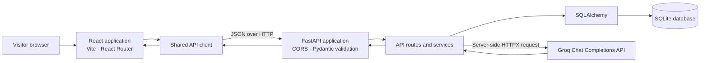

# 🌱 GreenGlow AI

### Celebrate thoughtfully. Live greener.

GreenGlow AI is a Diwali sustainability experience with interactive learning,
recycling guidance, daily challenges, community scores, and an AI assistant for
practical eco-friendly celebration ideas.

🌐 **Live application:** [green-glow-ai.vercel.app](https://green-glow-ai.vercel.app/)

[](LICENSE)


> **Project status:** The frontend and backend features described below are
> implemented in this repository. No CI workflow or automated build-status
> badge is currently present.

## 📚 Contents

- [About](#about-the-project)
- [Features](#features)
- [Technology](#technology)
- [Architecture](#system-architecture)
- [Repository layout](#repository-layout)
- [Setup](#installation-setup)
- [Environment variables](#environment-variables)
- [API](#api-reference)
- [AI integration](#ai-integration)
- [Testing](#testing)
- [Using GreenGlow](#usage)
- [Security notes](#security-considerations)
- [Roadmap](#roadmap)
- [Contributing](#contributing)
- [License and credits](#license-credits)
- [Support](#support)

<a id="about-the-project"></a>
## 📖 About the project

Diwali celebrations can involve extra waste, energy use, and pollution.
GreenGlow makes sustainability easier to explore through short quizzes, a waste
sorting game, practical challenges, and a question-and-answer assistant.

The project is intended for people who want approachable ideas for a more
thoughtful Diwali, as well as developers interested in a small full-stack
React and FastAPI application. Activity results and points are stored in the
backend database and can be viewed through a profile selected by email.

<a id="features"></a>
## ✨ Features

- 🪔 A responsive Diwali-themed landing page introducing the experiences.
- 📧 Email selection stored in browser local storage. Email is an identifier,
  **not** an authenticated account or proof of identity.
- 🌿 Green Quiz sessions with ten questions, answer review, and points awarded
  for correct answers. Completing a quiz can create a backend profile.
- ♻️ Eco Sort game that issues ten waste items, checks categories on the
  backend, and records the result once per session.
- ✅ Daily challenges with per-profile completion status, duplicate-completion
  protection, and points.
- 💬 AI Assistant endpoint for eco-friendly Diwali suggestions, optional
  personalization, request validation, and response safety screening.
- 🏆 Green Score dashboard with a score breakdown, activity summary,
  achievements, and recent activity.
- 📊 Leaderboard ranked by score.
- 🔌 FastAPI health check and interactive API documentation.
- 📱 Responsive layouts and reduced-motion handling in the frontend.

<a id="technology"></a>
## 🛠️ Technology

| Area | Technologies confirmed in the project |
|---|---|
| Frontend | React, React Router, Vite, Tailwind CSS via the Vite plugin, Motion, Lucide |
| Backend | FastAPI, Uvicorn, Pydantic, SQLAlchemy |
| Languages | Python, JavaScript, HTML, CSS |
| Database | SQLite by default; SQLAlchemy database URL is configurable |
| AI integration | Groq Chat Completions HTTP API, called using HTTPX |
| API / configuration | JSON REST endpoints, `python-dotenv`, CORS middleware |
| Development tools | npm scripts, Vite development server, Uvicorn, Git |
| Database migrations | Alembic migrations are included |
| Testing | pytest, FastAPI `TestClient`, isolated SQLite test databases, mocked provider calls |

The declared dependency ranges are in [backend/requirements.txt](backend/requirements.txt)
and [frontend/package.json](frontend/package.json); the frontend lockfile is
[frontend/package-lock.json](frontend/package-lock.json).

<a id="system-architecture"></a>
## 🏗️ System architecture

The browser uses the shared frontend API client to send JSON requests to the
FastAPI application. API routes validate requests with Pydantic, call domain
services, and use SQLAlchemy to read or update the database. AI-powered
responses and generated content use the backend-only Groq integration.



The selected email is kept in browser local storage and sent by the frontend
to endpoints that need to associate activity with a profile. There is no
authentication or authorization layer in the current implementation.

### Persistent data

- `users` stores a unique username and email plus the accumulated score.
- `quizzes` stores question text, options, correct option, explanation, and
  category.
- `quiz_sessions` records session tokens, issued question IDs, email binding,
  and submission time. `quiz_attempts` stores the result for a user and can
  reference a quiz session.
- `challenges` stores active challenge content and point values.
  `challenge_completions` records points awarded and prevents the same user
  from completing the same challenge twice.
- `eco_sort_game_sessions` stores the issued item IDs, submitting user,
  submission time, and awarded score.

<a id="repository-layout"></a>
## 📂 Repository layout

```text
GreenGlow-AI/
├── backend/
│   ├── app/
│   │   ├── models/          # SQLAlchemy tables and constraints
│   │   ├── routes/          # FastAPI endpoint handlers
│   │   ├── schemas/         # Pydantic request and response models
│   │   ├── services/        # AI, Eco Sort, score, and user lookup logic
│   │   ├── database.py      # SQLAlchemy engine and session dependency
│   │   ├── main.py          # App setup, CORS, startup, and router mounting
│   │   └── seed.py          # Initial quiz questions and challenges
│   ├── migrations/          # Alembic configuration and revisions
│   ├── tests/               # Backend endpoint and service tests
│   ├── .env.example         # Example APP_ENV and CORS settings
│   ├── alembic.ini
│   └── requirements.txt
├── frontend/
│   ├── src/
│   │   ├── app/             # Client-side route configuration
│   │   ├── context/         # Selected-email context
│   │   ├── pages/           # Home and feature pages
│   │   ├── services/        # API client and endpoint paths
│   │   └── styles/          # Theme and application styles
│   ├── .env.example         # Frontend API base URL
│   ├── package.json
│   └── vite.config.js
├── .gitignore
├── LICENSE
└── README.md
```

<a id="installation-setup"></a>
## ⚙️ Installation & setup

### Prerequisites

- Git
- Python 3.10 or later (the backend uses Python 3.10+ type syntax)
- Node.js `^20.19.0` or `>=22.12.0` and npm, as required by the locked Vite toolchain
- A Groq API key for live AI Assistant responses and AI-generated content

### 1. Clone the repository

```powershell
git clone https://github.com/adityashukla15/GreenGlow-AI.git
Set-Location GreenGlow-AI
```

### 2. Configure and run the backend

In PowerShell:

```powershell
Set-Location .\backend
python --version
python -m venv .venv
.\.venv\Scripts\Activate.ps1
python -m pip install --upgrade pip
python -m pip install -r requirements.txt
Copy-Item .env.example .env
```

Open `backend\.env` and add a Groq key for live AI features. The key must stay
in the backend environment; do not put it in a `VITE_` variable or frontend
file:

```dotenv
GROQ_API_KEY=your_groq_api_key
# Optional; defaults to llama-3.3-70b-versatile
GROQ_MODEL=llama-3.3-70b-versatile
```

Start the API from the `backend` directory:

```powershell
uvicorn app.main:app --reload
```

At startup, the application creates missing tables and seeds initial quiz
questions and challenges. With the default database setting, SQLite creates
`backend\greenglow.db`. Alembic migration files are included, but the
application startup does not automatically run `alembic upgrade`.

### 3. Configure and run the frontend

Open a second PowerShell window from the repository root:

```powershell
Set-Location .\frontend
npm ci
Copy-Item .env.example .env.local
npm run dev
```

The included frontend example points to `http://127.0.0.1:8000`. Change
`VITE_API_BASE_URL` in `frontend\.env.local` if the backend is hosted elsewhere.

### Local URLs

| Service | URL |
|---|---|
| Live application | <https://green-glow-ai.vercel.app/> |
| Frontend | <http://localhost:5173> |
| Backend root | <http://127.0.0.1:8000/> |
| Health check | <http://127.0.0.1:8000/health> |
| Interactive API docs | <http://127.0.0.1:8000/docs> |
| OpenAPI schema | <http://127.0.0.1:8000/openapi.json> |

To create a production frontend bundle, run `npm run build` in `frontend`.
There is no production deployment or hosting configuration defined in this
repository.

<a id="environment-variables"></a>
## 🔐 Environment variables

The backend loads environment variables with `python-dotenv`. The frontend
example is [frontend/.env.example](frontend/.env.example); the backend example
is [backend/.env.example](backend/.env.example). The backend example currently
contains only `APP_ENV` and `CORS_ORIGINS`; the application also reads the
variables below when they are supplied.

| Variable | Used by | Required? | Purpose and safe value |
|---|---|---:|---|
| `APP_ENV` | Backend | No | `development` by default. Development mode allows the two local Vite origins. Other values use the explicit `CORS_ORIGINS` list. |
| `CORS_ORIGINS` | Backend | In non-development environments | Comma-separated explicit origins, e.g. `https://your-app.example`. Wildcards, paths, query strings, and fragments are rejected. |
| `DATABASE_URL` | Backend | No | SQLAlchemy connection URL. Defaults to `sqlite:///./greenglow.db`, relative to the backend process working directory. |
| `GROQ_API_KEY` | Backend | For live AI calls | Server-side Groq credential. Do not commit it or expose it to the browser. |
| `GROQ_MODEL` | Backend | No | Groq model name; defaults to `llama-3.3-70b-versatile`. |
| `VITE_API_BASE_URL` | Frontend | No | Backend origin, default `http://127.0.0.1:8000`. This is a public URL setting, not a place for secrets. |

Production origins should be HTTPS origins for the deployed frontend. The
application configures CORS but does not itself enforce HTTPS; configure TLS at
the hosting or reverse-proxy layer. Never commit `.env` files.

<a id="api-reference"></a>
## 🔌 API reference

All API routes use the `/api/v1` prefix except `/` and `/health`. Requests and
responses are JSON unless noted. Authentication is **not required or
implemented**: user-specific operations generally accept a caller-supplied
email address, which is an identifier only.

| Method | Endpoint | Purpose and request | Response overview |
|---|---|---|---|
| `GET` | `/` | API root | Welcome message and running status |
| `GET` | `/health` | Check application/database connectivity | Health status; `503` if the database check fails |
| `GET` | `/api/v1/quiz/questions` | List available questions | Question IDs, prompt, options, category; does not return the correct option |
| `POST` | `/api/v1/quiz/session/start` | Body: `{"email":"person@example.com"}` | Session token and ten questions; may request new questions from Groq if too few unused questions remain |
| `POST` | `/api/v1/quiz/session/submit` | Body: session token, username, email, and exactly ten `{question_id, selected_option}` answers | Per-answer evaluation, quiz score, correct/incorrect totals; creates a profile on first successful submission |
| `POST` | `/api/v1/quiz/submit` | Legacy non-session quiz submission; body: username, email, and answers | Quiz result and score |
| `GET` | `/api/v1/challenges/` | List active challenges | Challenge ID, title, description, and points |
| `GET` | `/api/v1/challenges/completions?email=person%40example.com` | Query: email | `profile_exists` and completed challenge IDs |
| `POST` | `/api/v1/challenges/{challenge_id}/complete` | Body: `{"email":"person@example.com"}` | Completion message, points awarded, and total score |
| `GET` | `/api/v1/eco-sort/items` | List public waste-sorting items | Item ID, name, and description; correct categories are not exposed |
| `POST` | `/api/v1/eco-sort/start` | Body: `{"email":"person@example.com"}`; profile must exist | Game session token and ten issued items |
| `POST` | `/api/v1/eco-sort/submit` | Body: email, session token, and category answers for exactly the issued items | Per-item evaluation, points awarded, and total score |
| `GET` | `/api/v1/green-score?email=person%40example.com` | Query: email; profile must exist | Total points, score breakdown, activity summary, achievements, and up to ten recent activities |
| `GET` | `/api/v1/leaderboard/?limit=10` | Optional limit, integer from 1 to 100 (default 10) | Ranked usernames and scores |
| `POST` | `/api/v1/ai/assistant` | Message and optional preferences | Assistant reply and provider label (`groq`) |

Pydantic validation errors are returned as `422`. Challenge duplicate
completion and repeated session submission are protected (`409`); ownership
mismatches return `403`. Missing users, sessions, or resources can return
`404`. AI-provider failures are mapped to a safe `503` response.

### Assistant request example

```json
{
  "message": "Suggest sustainable Diwali decorations",
  "preferences": {
    "budget": "low",
    "interests": ["DIY decorations", "reusable items"]
  }
}
```

`message` is trimmed, non-empty, and limited to 2,000 characters.
Personalization fields are optional: `budget`, `interests`,
`decoration_interests`, and `celebration_style`.

Example response:

```json
{
  "reply": "Consider reusing decorations you already have...",
  "provider": "groq"
}
```

### Challenge completion status example

```json
{
  "profile_exists": true,
  "completed_challenge_ids": [2, 4]
}
```

FastAPI's interactive endpoint explorer is available at `/docs` while the
backend is running.

<a id="ai-integration"></a>
## 🧠 AI integration

The backend calls Groq's OpenAI-compatible Chat Completions HTTP endpoint with
HTTPX. `GROQ_API_KEY` is read by backend code only; `GROQ_MODEL` selects the
model and defaults to `llama-3.3-70b-versatile`.

The AI Assistant builds a focused Diwali sustainability prompt and includes
provided preferences when present. Groq responses have a server-side safety
screen for selected risky advice patterns and invalid/empty output. Provider
timeouts, HTTP errors, malformed replies, and missing configuration are
handled as service errors; the assistant route returns a generic `503` instead
of exposing provider details.

The same Groq service can generate structured quiz questions and challenges.
Pydantic validates generated content. When quiz generation fails, quiz
sessions can use enough existing database questions; otherwise the quiz-session
start request returns `503`. Challenge generation replenishes the challenge
pool after completion; generation failure does not undo a completion. These
checks reduce risk but do not guarantee that generated content is always
correct or safe.

<a id="testing"></a>
## 🧪 Testing

Backend tests use pytest, FastAPI's test client, temporary SQLite databases,
and mocked Groq calls. Existing tests cover API validation, quiz sessions and
scoring, Eco Sort submissions and duplicate prevention, challenge completion
and replenishment, Green Score aggregation, CORS, AI error cases, and selected
unsafe or malformed provider responses.

From `backend`, run the suite with:

```powershell
.\.venv\Scripts\Activate.ps1
python -c "from app.main import app; app.dependency_overrides = app.app.dependency_overrides; import pytest; raise SystemExit(pytest.main(['tests', '-q']))"
```

The bootstrap shown above is currently needed because `app.main` exports the
CORS middleware wrapper while the shared test fixture expects
`dependency_overrides` on that exported object. Running plain `pytest -q`
currently fails during fixture setup with an `AttributeError`; the bootstrap
aliases the wrapped FastAPI application's overrides for the test process.
No live Groq request is needed for the automated tests.

The frontend package currently defines `dev`, `build`, and `preview` scripts;
it does not define a frontend test or lint script.

<a id="usage"></a>
## 🚀 Usage

1. Start the backend and frontend using the setup steps above.
2. Open the frontend and choose an email at onboarding. Use the same email
   associated with an existing backend profile to see its activities.
3. If new to GreenGlow, complete a quiz; a successful quiz submission creates
   a profile and awards points.
4. Play Eco Sort, complete available challenges, and review activity and
   achievements on **My Green Score**.
5. Use **Leaderboard** to view the highest scores and **AI Assistant** to ask
   for eco-friendly Diwali ideas.

AI features require a reachable Groq API with valid backend configuration.
Email selection does not create an account, authenticate a person, or protect
their profile.

<a id="security-considerations"></a>
## 🔒 Security considerations

- **No authentication or authorization:** Email-based profile lookup is not
  identity verification. A user can submit another person's email to
  user-specific endpoints. Do not use this design for private or sensitive
  production data without adding an authentication and authorization layer.
- **Keep provider credentials server-side:** Never put `GROQ_API_KEY` in
  frontend code, browser storage, or any `VITE_` variable. The browser only
  calls the GreenGlow API.
- **CORS:** Development allows `localhost:5173` and `127.0.0.1:5173`.
  Non-development environments require explicit allowed origins; wildcard
  origins are rejected.
- **Input and output validation:** Pydantic validates request and generated
  content. The API also prevents repeated quiz-session submissions and
  duplicate challenge completions.
- **Transport security:** HTTPS is not enforced by the application. Enable
  HTTPS at the deployment platform or reverse proxy and use secure database
  and secret-management practices.
- **AI output:** Prompt instructions and pattern checks are not a substitute
  for human review or a guarantee of safe, factual advice.
- **Database configuration:** SQLite is the default. Back up persistent data
  and plan schema upgrades; Alembic migrations are included but are not run
  automatically at startup.

<a id="roadmap"></a>
## 🗺️ Roadmap

### Implemented

- Responsive landing page, onboarding, dashboard, quiz, Eco Sort, challenges,
  AI assistant, and leaderboard.
- FastAPI endpoints, SQLite persistence, scoring, seeded content, and Alembic
  migration files.
- Groq-backed conversational and structured content generation.

### Proposed future work (not implemented or scheduled)

- Add verified authentication and authorization before treating profile data
  as private.
- Add continuous integration for backend tests and frontend builds.
- Define deployment-specific HTTPS, database backup, and migration procedures.

No separate product roadmap was found in the repository. The items above are
recommendations, not existing features or committed release plans.

<a id="contributing"></a>
## 🤝 Contributing

Contributions are welcome. A straightforward workflow:

1. Fork the repository and create a focused feature branch.
2. Keep changes scoped and avoid committing `.env` files, API keys, or local
   database files.
3. Add or update tests for backend behavior; do not make real provider calls
   in automated tests.
4. Run the backend test command above and `npm run build` from `frontend`.
5. Open a pull request describing the change, validation performed, and any
   configuration or migration implications.

<a id="license-credits"></a>
## 📄 License & credits

This project is distributed under the MIT License; see [LICENSE](LICENSE).
The license file's copyright notice names Aditya Shukla.

<a id="support"></a>
## ⭐ Support

If GreenGlow is useful to you, consider starring the repository and sharing a
focused contribution. Thoughtful feedback helps the project grow greener.